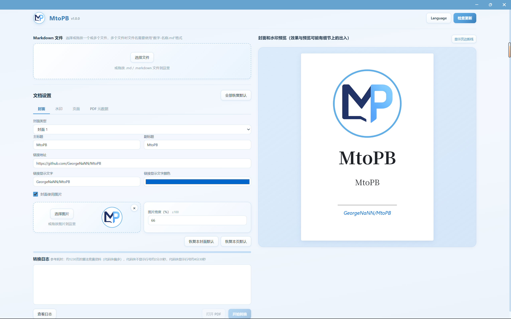
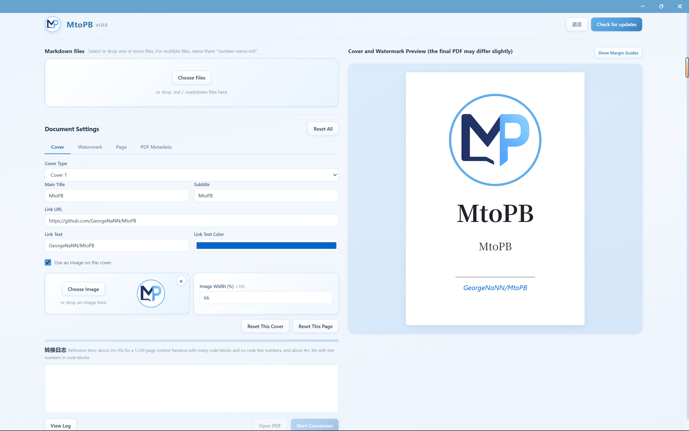
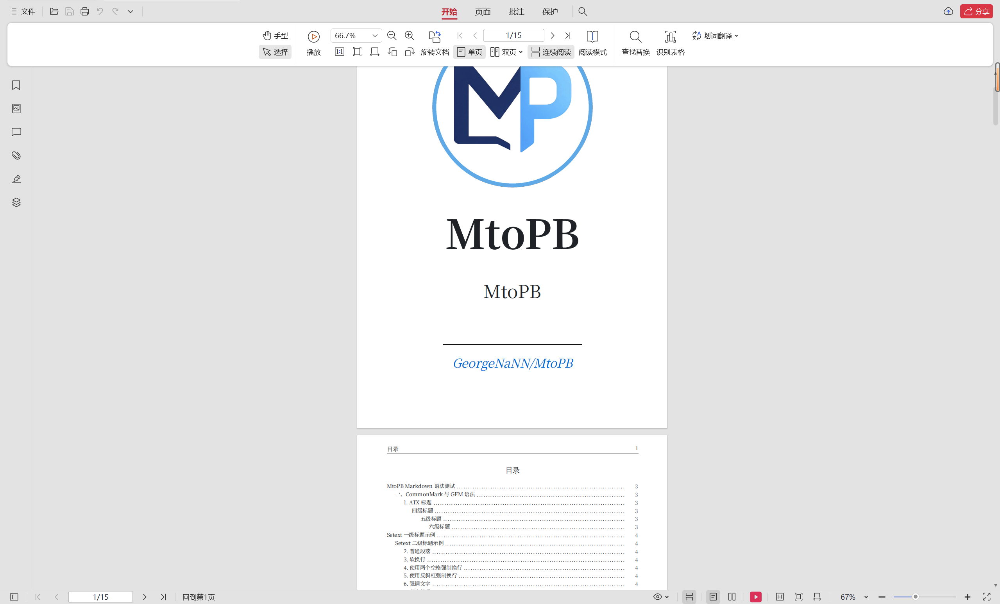

## 1. Introduction

MtoPB is a Windows desktop application built with [Electron](https://github.com/electron/electron). It combines one or more Markdown files and exports them as a PDF. The application uses its built-in Chromium to lay out HTML and render the PDF, then applies post-processing such as page numbers, table-of-contents page numbers, bookmarks, and watermarks.

## 2. Project Information

- Author: [GeorgeNaNN](https://github.com/GeorgeNaNN)
- Version: `v1.0.0`
- Project name: `MtoPB`
- Purpose: Format one or more Markdown files into a PDF with a cover, table of contents, and bookmarks
- Repository: [MtoPB](https://github.com/GeorgeNaNN/MtoPB)
- Downloads: [MtoPB/releases](https://github.com/GeorgeNaNN/MtoPB/releases)
- Framework: [Electron](https://github.com/electron/electron)
- Technology stack: `HTML` / `CSS` / `JavaScript` / `markdown-it` / `Chromium` / `pdf-lib`
- Platform: `Windows x64`
- Author's QQ (for questions): [3467842596](https://qm.qq.com/q/V8mHMtuFIk)

## 3. Core Features

| Feature | Description |
| :--- | :--- |
| Markdown merging | Select one or more `.md` / `.markdown` files. When multiple files are selected, they are merged in the numeric order in their filenames, such as `1-Introduction.md` and `2-Main text.md`. |
| PDF generation | Uses Electron's built-in Chromium to lay out HTML and render it as a PDF. |
| Covers | Includes several cover templates and supports uploading a one-page PDF as a custom cover. |
| Table of contents and bookmarks | Generates the table of contents from headings. PDF bookmarks are created from its entries and use the same heading levels. |
| Headers and page numbers | Configure the page-numbering rule and add headers and page numbers to body pages. |
| Watermarks | Add a watermark to the generated PDF. Watermarks are not affected by the page margins configured under “Page”. |
| Pagination settings | Separately configure whether images, code blocks, and tables may span pages or should preferably stay on one page. Other body content follows the project's pagination rules. |
| PDF metadata | Enter a title, author, subject, and keywords to write to the PDF document properties. |

## 4. File Structure

```text
MtoPB/
├── covers/             # Cover templates
├── docs/               # Syntax documentation and test documents
├── example_images/     # Images used in this README
├── fonts/              # Fonts used for PDF typesetting
├── ico/                # Application icons and the default cover image
├── locales/            # Language resources required by Electron
├── resources/          # Application code, templates, and runtime dependencies
├── config.yml          # Application version and default settings
├── LICENSE             # MIT License
├── MtoPB.exe           # Windows desktop application
├── README.en.md        # English project documentation
├── README.md           # Chinese project documentation
├── sync.bat            # Syncs the configured version to the application metadata
└── Other               # Other runtime files required by Electron and Chromium
```

## 5. Application Pages

### (1) Supported Markdown Syntax

Syntax support is grouped into three categories: [0.29-GFM](https://github.github.com/gfm/) (covering all syntax types defined by the specification; see the detailed documentation for compatibility boundaries and local rendering differences), extensions provided by third-party plugins, and custom syntax implemented by MtoPB. See [docs/syntax.txt](docs/syntax.txt) for the complete syntax reference, [docs/syntax-test.md](docs/syntax-test.md) for the test document, and [docs/syntax-test.pdf](docs/syntax-test.pdf) for its generated PDF.

### (2) Headings

The baseline body text size for printing is `11pt`. Heading sizes are set relative to this baseline in the current print styles:

| Markdown heading | Font size | Space above | Space below |
| :--- | ---: | ---: | ---: |
| Level 1 `#` | `20.35pt` (`1.85em`) | `1.4em` (`15.4pt`) | `0.6em` (`6.6pt`) |
| Level 2 `##` | `15.95pt` (`1.45em`) | `1.4em` (`15.4pt`) | `0.6em` (`6.6pt`) |
| Level 3 `###` | `13.2pt` (`1.2em`) | `1.2em` (`13.2pt`) | `0.5em` (`5.5pt`) |
| Level 4 `####` | `11pt` (`1em`) | `1.2em` (`13.2pt`) | `0.5em` (`5.5pt`) |
| Level 5 `#####` | About `9.13pt` (Chromium default `0.83em`) | `1.2em` (`13.2pt`) | `0.5em` (`5.5pt`) |
| Level 6 `######` | About `7.37pt` (Chromium default `0.67em`) | `1.2em` (`13.2pt`) | `0.5em` (`5.5pt`) |

These values are the top and bottom margins set on each heading in the print CSS. The final visible gap between a heading and following content is also affected by margin collapsing between adjacent elements. The project explicitly sets level 4 headings to `1em`; levels 5 and 6 have no explicit font-size rule and use Chromium defaults. A level 1 heading at the start of a chapter uses a smaller top margin of `0.6em`.

### (3) Pagination Rules

| Body content | Rule in this project |
| ------------------------ | :----------------------------------------------------------: |
| Standalone Markdown images | Configurable under “Page”; allowed to span pages by default. The rule applies to the image-and-caption group, which may fall on separate pages when spanning is allowed. |
| Tables | Configurable under “Page”; allowed to span pages by default. |
| Code blocks | Configurable under “Page”; allowed to span pages by default. |
| Table rows | Prefer to keep together on one page. |
| `:::` callout blocks | Prefer to keep together on one page. |
| GitHub Alerts | Prefer to keep together on one page. |
| Custom environment blocks | Prefer to keep together on one page. |
| Block quotes | Prefer to keep together on one page. |
| Formula blocks | Allowed to span pages. |
| Body paragraphs | Allowed to span pages. |
| Lists and task lists | Allowed to span pages. |


## 6. Conversion Time Reference

Reference timings are based on an algorithm-contest document of about `1,230` pages with many code blocks:

| Conversion setting | Approximate time |
| :--: | :--: |
| Code line numbers disabled | About `2 minutes 20 seconds` |
| Code line numbers enabled | About `4 minutes 30 seconds` |

Actual conversion time varies with document length, the number of images and code blocks, pagination settings, and computer performance. These figures are estimates, not guaranteed completion times.


## 7. Notes

- The application does not specifically scan Markdown and report unsupported syntax. Unrecognized constructs are handled as ordinary text by the Markdown engine; syntax recognized by the engine, including enabled extensions, is rendered normally.
- The table of contents is generated from Markdown headings in the merged document, not from filenames.
- PDF bookmarks are added automatically and use the same heading entries and level range as the main table of contents.
- HTML, CSS, and JavaScript in documents are processed by the local HTML rendering pipeline. The actual result depends on Chromium and the content itself.
- A custom PDF cover must contain one page. Its page size should match the paper size selected under “Page”.
- Relative paths to local resources such as images are resolved from the location of the Markdown file that uses them.
- If conversion fails, check the log file with the same name as the output file in the `res` folder, or click “View Log” in the application.
- When selecting multiple Markdown files, filenames must follow the `number-name.md` format, such as `1-Introduction.md`. Intermediate files and logs created during conversion are stored in the `res` folder under the project directory.


# 8. Example Screenshots

### Chinese Interface



### English Interface



### Result Image for the Converted [PDF](docs/syntax-test.pdf)


