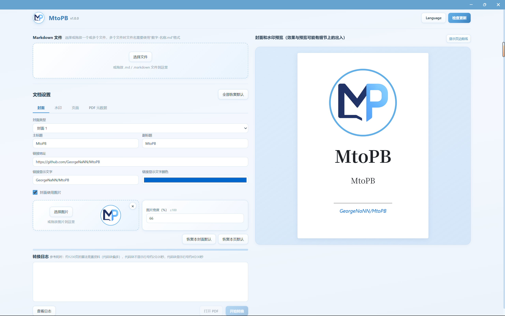
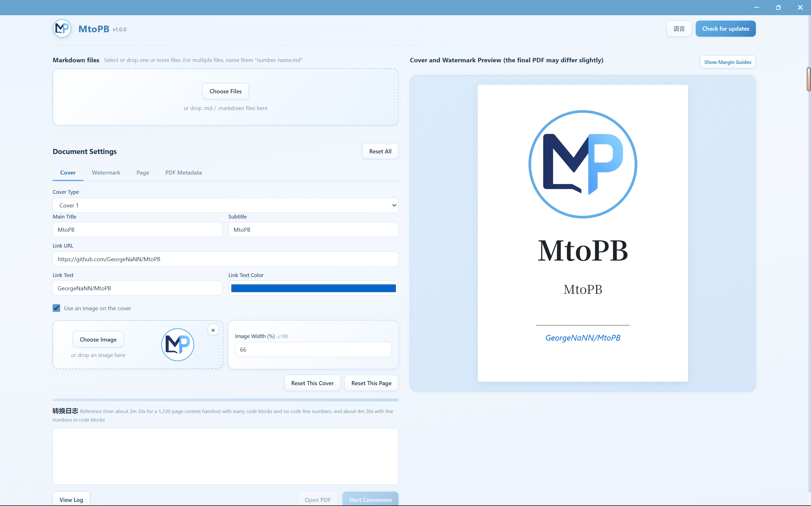
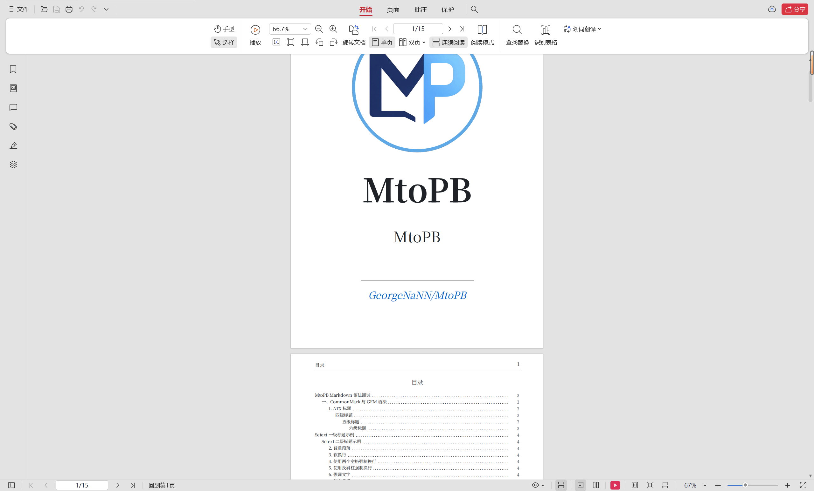

<h1 align="center"><sub></sub> MtoPB</h1>

<p align="center">
  
</p>
<p align="center" style="margin-top: 8px; font-size: 18px;">
  Markdown 转 PDF · 支持md多文件合并、封面、目录与 PDF 书签
</p>
<p align="center">
  <a href="LICENSE"></a>
  <a href="https://github.com/electron/electron"></a>
  
  
  <a href="https://github.com/GeorgeNaNN/MtoPB"></a>
  <a href="https://github.com/GeorgeNaNN/MtoPB/commits"></a>
</p>
<p align="center">
  <strong>Language / 语言</strong><br>
  <a href="README.md"></a>
  <a href="README.en.md"></a>
</p>


---

## 一、简介

MtoPB 全称为 Markdown to PDF Book，是一款基于 [Electron](https://github.com/electron/electron) 构建的 Windows 桌面软件，可将一个或多个 Markdown 文件合并并生成 PDF。软件使用内置 Chromium 将 HTML 排版并生成 PDF，再对 PDF 进行页码、目录页码、书签、水印等后处理。

## 二、项目信息

- 作者：[GeorgeNaNN](https://github.com/GeorgeNaNN)
- 版本：`v1.0.0`
- 项目名：`MtoPB`
- 项目定位：将一个或多个 Markdown 文件排版为带封面、目录和书签的 PDF
- 仓库：[MtoPB](https://github.com/GeorgeNaNN/MtoPB)
- 下载地址：[MtoPB/releases](https://github.com/GeorgeNaNN/MtoPB/releases)
- 基于的框架：[Electron](https://github.com/electron/electron)
- 技术栈：`HTML` / `CSS` / `JavaScript` / `markdown-it` / `Chromium` / `pdf-lib`
- 运行平台：`Windows x64`
- 作者 QQ（有问题请联系作者）：[3467842596](https://qm.qq.com/q/V8mHMtuFIk)

## 三、核心功能

| 功能 | 说明 |
| :--- | :--- |
| Markdown 合并 | 支持选择一个或多个 `.md` / `.markdown` 文件；多个文件按文件名中的数字顺序合并，例如 `1-简介.md`、`2-正文.md` |
| PDF 生成 | 使用 Electron 内置 Chromium 将 HTML 排版并生成 PDF |
| 封面 | 提供多种内置封面，并支持上传一页 PDF 作为自定义封面 |
| 目录与书签 | 按标题生成目录；PDF 书签由目录条目生成，目录选择几级，书签就对应几级 |
| 页眉、页码 | 可配置页码计数规则，并在正文页生成页眉和页码 |
| 水印 | 可为生成的 PDF 添加水印；水印不受页面页边距设置影响 |
| 分页设置 | 可分别设置图片、代码块和表格允许跨页或尽量不跨页，其他正文块按项目分页规则处理 |
| PDF 元数据 | 可填写标题、作者、主题和关键字，写入 PDF 文档属性 |

## 四、文件结构

```text
MtoPB/
├── covers/             # 封面模板
├── docs/               # 语法说明与测试文档
├── example_images/     # README 示例图片
├── fonts/              # 字体文件
├── ico/                # 软件图标与默认封面图片
├── locales/            # Electron 运行所需的语言资源
├── resources/          # 应用程序代码、模板及运行依赖
├── config.yml          # 软件版本与默认配置
├── LICENSE             # MIT 许可证
├── README.en.md        # 英文项目说明
├── README.md           # 中文项目说明
├── sync.bat            # 将配置中的版本号同步到程序信息
└── Other               # Electron 和 Chromium 运行所需的其他程序文件
```

## 五、页面

### （1）支持的md语法 

项目支持的语法分为三类：[0.29-GFM](https://github.github.com/gfm/)（覆盖该规范定义的全部语法类型，具体兼容边界和本地渲染差异见详细说明）、第三方插件提供的扩展语法，以及 MtoPB 自身实现的自定义语法。完整语法说明见 [docs/syntax.txt](docs/syntax.txt)，测试文档见 [docs/syntax-test.md](docs/syntax-test.md)，对应生成的 PDF 见 [docs/syntax-test.pdf](docs/syntax-test.pdf)。

### （2）标题

正文打印基准字号为 `11pt`。标题字号按当前打印样式相对于正文基准字号设置：

| Markdown 标题 | 字号 | 上方间距 | 下方间距 |
| :--- | ---: | ---: | ---: |
| 一级标题 `#` | `20.35pt`（`1.85em`） | `1.4em`（`15.4pt`） | `0.6em`（`6.6pt`） |
| 二级标题 `##` | `15.95pt`（`1.45em`） | `1.4em`（`15.4pt`） | `0.6em`（`6.6pt`） |
| 三级标题 `###` | `13.2pt`（`1.2em`） | `1.2em`（`13.2pt`） | `0.5em`（`5.5pt`） |
| 四级标题 `####` | `11pt`（`1em`） | `1.2em`（`13.2pt`） | `0.5em`（`5.5pt`） |
| 五级标题 `#####` | 约 `9.13pt`（Chromium 默认 `0.83em`） | `1.2em`（`13.2pt`） | `0.5em`（`5.5pt`） |
| 六级标题 `######` | 约 `7.37pt`（Chromium 默认 `0.67em`） | `1.2em`（`13.2pt`） | `0.5em`（`5.5pt`） |

间距是打印 CSS 中标题自身设置的上下外边距；标题与后续段落等内容之间的最终视觉距离还会受到相邻元素外边距折叠影响。四级标题的字号由项目样式明确设为 `1em`；五、六级标题没有单独指定字号，沿用 Chromium 默认值。章节开头的一级标题会使用较小的顶部间距 `0.6em`。

### （3）分页规则

|         正文内容         |                        当前项目的规则                        |
| ------------------------ | :----------------------------------------------------------: |
| 单独成段的 Markdown 图片 | 页面可设置，默认允许跨页；规则作用于整组图片和图注，允许跨页时两者可能分到不同页 |
|           表格           |                   页面可设置，默认允许跨页                   |
|          代码块          |                   页面可设置，默认允许跨页                   |
|          表格行          |                          尽量不跨页                          |
|       `:::` 提示框       |                          尽量不跨页                          |
|      GitHub Alerts       |                          尽量不跨页                          |
|       自定义环境块       |                          尽量不跨页                          |
|          引用块          |                          尽量不跨页                          |
|          公式块          |                           允许跨页                           |
|         正文段落         |                           允许跨页                           |
|      列表和任务列表      |                           允许跨页                           |


## 六、转换耗时参考

以约 `1,230` 页、代码块较多的算法竞赛资料为参考：

| 转换设置 | 参考耗时 |
| :--: | :--: |
| 代码块不显示行号 | 约 `2 分 20 秒` |
| 代码块显示行号 | 约 `4 分 30 秒` |

实际耗时会随文档页数、图片和代码块数量、分页设置以及电脑性能变化。以上时间是参考值，不是固定完成时间。


## 七、注意事项

- 软件不会专门扫描并报告 Markdown 中“不支持的语法”。无法识别的写法会按 Markdown 引擎的普通文本处理方式显示；能被引擎识别的标准语法和已启用扩展则会正常渲染。
- 标题目录依据合并后文档中的 Markdown 标题生成，不依据文件名生成。
- PDF 书签会自动注入，并与主目录采用相同的标题条目和级别范围。
- 文档中的 HTML、CSS 和 JavaScript 由本地 HTML 渲染流程处理；具体显示效果取决于 Chromium 和对应内容本身。
- 自定义 PDF 封面仅支持一页；建议其纸张大小与“页面”设置一致。
- 图片等本地资源使用相对路径时，会按其所属 Markdown 文件的位置解析。
- 转换失败时，可查看 `res` 文件夹中与输出文件同名的日志文件，或在软件中点击“查看日志”。
- 选择多个 Markdown 文件时，文件名需采用 `数字-名称.md` 格式，例如 `1-简介.md`。转换过程中生成的中间文件和日志位于项目文件夹下的 `res` 文件夹。


## 八、示例图

### 软件中文界面



### 软件英文界面



### 转换后的 [PDF](docs/syntax-test.pdf) 效果图


